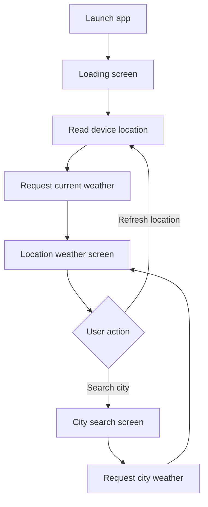

# Clima Weather

A Flutter weather app that shows current conditions for the user's location or a city entered manually. It retrieves current weather from the OpenWeatherMap Current Weather API and presents the temperature, condition icon, city name, and a short weather-based suggestion.

<p align="center">
  
  
  
  
</p>

## Features

- Fetch current weather using the device's location.
- Search for current weather by city name.
- Display temperature in Celsius.
- Map weather condition codes to emoji icons.
- Show a short suggestion based on the current temperature.
- Use separate loading, location, and city-search screens.

> This project currently displays **current weather only**. It does not implement hourly or multi-day forecasts.

## Technology

- Flutter and Dart
- OpenWeatherMap Current Weather API
- `geolocator` for device location
- `http` for API requests
- `flutter_spinkit` for the loading indicator

## Requirements

- Flutter SDK compatible with the Dart constraint in `pubspec.yaml` (Dart 2.x)
- Android Studio or Xcode for device builds
- An OpenWeatherMap API key
- A device or emulator with location services enabled for location-based weather

## Run locally

1. Clone the repository:

   ```bash
   git clone https://github.com/Brajesh31/live-weather-app-main.git
   cd live-weather-app-main
   ```

2. Install Flutter dependencies:

   ```bash
   flutter pub get
   ```

3. Supply your API key at run time. Do not put a real key in source control:

   ```bash
   flutter run --dart-define=OPENWEATHER_API_KEY=YOUR_API_KEY
   ```

   For a release build, pass the same define to the relevant build command, for example:

   ```bash
   flutter build apk --dart-define=OPENWEATHER_API_KEY=YOUR_API_KEY
   ```

4. Launch the app on a connected device or emulator.

The key is compiled into a client application and can be extracted from a distributed binary. Restrict it in the OpenWeatherMap dashboard where possible, monitor its usage, and never reuse a privileged server-side key in a mobile app.

## Project structure

```text
lib/
├── main.dart
├── screens/
│   ├── loading_screen.dart
│   ├── location_screen.dart
│   └── city_screen.dart
├── services/
│   ├── location.dart
│   ├── networking.dart
│   └── weather.dart
└── utilities/
    └── constants.dart
images/       # Screen backgrounds
fonts/        # App font assets
android/      # Android runner and platform configuration
ios/          # iOS runner and platform configuration
```

## Application flow



## API and permissions

The app calls the OpenWeatherMap Current Weather endpoint. Location-based weather requires location permission on the device. If permission is denied or the API request fails, the current implementation may not recover gracefully. Check platform permission configuration and network access when troubleshooting.

## Known limitations

- No forecast, saved cities, offline mode, or automated test suite is currently included.
- The project uses older Flutter/Dart dependencies and APIs. Upgrade the SDK and dependencies deliberately before adopting newer Flutter tooling.
- Network and location error handling should be strengthened before production release.
- The API key must be supplied through `--dart-define`; the previous hardcoded key has been removed from the source. Rotate the previously exposed key.

## Contributing

See [CONTRIBUTING.md](CONTRIBUTING.md). Bug reports and focused improvements are welcome.

## Security

Do not commit API keys, credentials, personal data, or signing files. See [SECURITY.md](SECURITY.md).

## License

This project is licensed under the MIT License. See [LICENSE](LICENSE).
