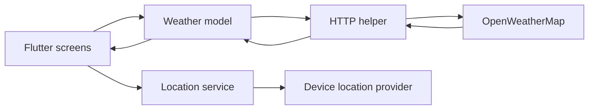

# Architecture

The application is a small Flutter client with a screen layer, service layer, and local UI constants.

## Responsibilities

- `screens/`: loading, current-location weather, and city search screens.
- `services/location.dart`: reads the device's latitude and longitude through Geolocator.
- `services/networking.dart`: performs HTTP GET requests and decodes JSON.
- `services/weather.dart`: builds OpenWeatherMap requests and maps condition codes to display values.
- `utilities/`: shared text styles and input decoration.

## Data flow

The client currently requests only current weather. There is no backend service or persistent local database.
